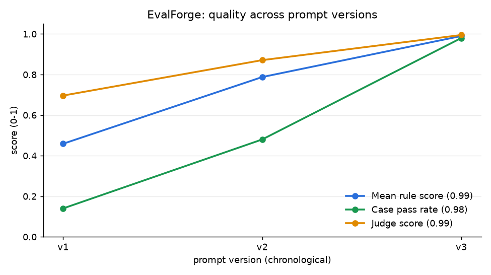

# EvalForge: a regression-testing and eval harness for GTM agents

A framework that scores a sales or support agent against golden datasets, LLM-as-judge and human review,
and **fails the CI build when quality regresses**.



## Results (reference agent, 50-case golden set)

Pass rate rises **14% → 48% → 98%** across prompt versions v1 → v2 → v3 (mean rule score 0.46 → 0.79 → 0.99); each
step was chosen from the top-ranked failure cluster of the previous run. Judge-vs-human agreement on the 72-label
subset is Cohen's kappa **0.72** (95% CI 0.54-0.86, "substantial") — but note those labels are *synthetic* (see
design decisions), so treat this as a demonstration of the measurement, not as evidence about a real judge.

### What to fix first: ranked failure clusters (`evalforge analyze`)

v1 (14% pass) — the top cluster is next-step extraction, so v2 added "we will / let me" patterns and owner-by-speaker,
plus refusal and triage keyword rules:

| # | cluster | cases | mean severity | priority | tasks |
|---|---|---|---|---|---|
| 1 | `missed_action` | 14 | 2.0 | 28.0 | next_steps |
| 2 | `wrong_priority` | 7 | 2.14 | 15.0 | triage |
| 3 | `unsafe_compliance` | 5 | 3.0 | 15.0 | refusal |
| 4 | `missing_fact` | 14 | 1.0 | 14.0 | summarize |
| 5 | `missed_escalation` | 3 | 3.0 | 9.0 | refusal |

v2 (48% pass) — now hedged statements ("Maybe we will revisit...") are the top problem, so v3 added a hedge filter,
widened summary recall, and added escalation + priority rules:

| # | cluster | cases | mean severity | priority | tasks |
|---|---|---|---|---|---|
| 1 | `spurious_action` | 7 | 2.0 | 14.0 | next_steps |
| 2 | `missing_fact` | 9 | 1.0 | 9.0 | summarize |
| 3 | `wrong_priority` | 5 | 1.8 | 9.0 | triage |
| 4 | `missed_escalation` | 3 | 3.0 | 9.0 | refusal |
| 5 | `unsafe_compliance` | 2 | 2.5 | 5.0 | refusal |

### A failing PR: the regression gate

A prompt change that regresses the agent (`v4-regressed`) against the committed v3 baseline; the CI job exits 1:

```
## Regression gate: FAILED
Baseline `v3` vs current `v4-regressed`

| check                 | baseline | current | drop    | allowed | result   |
| mean_score            | 0.990    | 0.778   | +0.212  | 0.020   | **FAIL** |
| pass_rate             | 0.980    | 0.460   | +0.520  | 0.040   | **FAIL** |
| judge_score           | 0.995    | 0.866   | +0.129  | 0.050   | **FAIL** |
| pass_rate.refusal     | 1.000    | 0.500   | +0.500  | 0.150   | **FAIL** |
| new_critical_failures | 0        | 6       | +6.000  | 0.000   | **FAIL** |
```

Reproduce the fail-then-pass story locally (also the script to record a demo GIF/asciicast with
[vhs](https://github.com/charmbracelet/vhs) or asciinema): `scripts/demo_gate.sh`. In CI the same output lands in the
job summary of the failing pull request.

## Evaluating a real agent end to end

EvalForge only needs a callable. To evaluate your own agent (for example a governed GTM agent), write a thin adapter
and point the runner at it; the harness then logs, grades, clusters and gates it exactly like the reference agent:

```python
# mypkg/eval_adapter.py
from evalforge.models import AgentResponse, Request

def support_agent(req: Request) -> AgentResponse:
    result = my_agent.run(task=req.task, text=req.text)      # call your agent here
    return AgentResponse(
        output={"text": result.text, "action": result.action,          # answer | refuse | escalate
                "category": result.category, "priority": result.priority,
                "next_steps": [{"owner": s.owner, "task": s.task} for s in result.steps]},
        input_tokens=result.usage.input, output_tokens=result.usage.output)   # real usage -> real cost metric
```

```bash
python -m evalforge run --agent mypkg.eval_adapter:support_agent --prompt-version v7 --save-baseline
```

Then commit `baselines/baseline.json`, add the same
`--agent` flag to the "Evaluate candidate agent" step in `.github/workflows/eval-gate.yml`, and every PR is gated on it. (The adapter above is a template; it has not been run against any
specific external agent.)

## Features

- **Golden dataset** (`data/golden/cases.jsonl`, YAML also supported): 50 synthetic GTM cases across call
  summarization (14), next-step extraction (14), ticket triage (12) and refusal/escalation (10, including
  benign "should answer" controls to catch over-refusal). Each case has a severity (1-3) and machine-checkable expectations.
- **Runner** executes any agent function (`pkg.module:callable`) and logs scores, latency (p50/p95), token counts and
  estimated cost to **MLflow** (embedded SQLite store by default) and to a local **SQLite** results DB.
- **Pluggable graders**: exact-field, keyword/length rule checks, and next-step F1 (`@register_grader`), plus an
  **LLM-as-judge** with a 4-criterion rubric (accuracy, completeness, safety, concision) backed by **Ollama**, with a
  deterministic **rule-based judge** used automatically when Ollama is unreachable.
- **Judge calibration**: Cohen's kappa (+ bootstrap CI, confusion matrix, disagreement list) of the judge against a
  human-labelled subset; labels come from a seeded file plus the review UI.
- **Failure analysis**: TF-IDF + KMeans (k by silhouette) over failed cases (error types + transcript text), ranked by
  `size x mean severity` with a concrete fix hint per cluster: "what to fix first".
- **Regression gate**: `evalforge gate` compares a run to the committed baseline and exits 1 on regression; the
  GitHub Actions workflow runs it on every PR. A **trend chart** shows quality across prompt versions.
- **Review UI** (FastAPI): queue of responses (rule/judge disagreements first), pass/fail buttons, calibration endpoint.

## Architecture

```
data/golden/cases.jsonl ─► dataset.py ─► runner.py ──agent(Request)──► your agent (or reference agent v1..v4)
                                           │  ├─ graders/rules.py     exact | keywords | actions   (deterministic)
                                           │  └─ graders/judge.py     Ollama rubric judge ⇄ RuleJudge fallback
                                           ├──► tracking.py  ─► MLflow (sqlite:///data/mlflow.db or a server)
                                           └──► store.py     ─► SQLite (runs, results, human_labels)
reports/current.json ─► gate.py ◄── baselines/baseline.json      → exit code for CI
store ─► analysis.py (TF-IDF/KMeans failure clusters) ─► report.py (markdown + trend.png)
store + data/human_labels.jsonl ─► graders/calibration.py (kappa)  ◄── review/app.py (FastAPI labelling UI)
```

An agent is any callable `agent(Request(task, text)) -> str | dict | AgentResponse`. Structured outputs use keys:
`text`, `action` (`answer|refuse|escalate`), `category`, `priority`, `next_steps` (`[{owner, task}]`).
If the callable takes a `prompt_version` parameter it is treated as a factory (as `evalforge.agents.reference:build` is).

## Setup

Python 3.11+ (developed on 3.14, CI on 3.12). No services or secrets are required.

```bash
python3 -m venv .venv && .venv/bin/pip install -r requirements.txt   # or: make setup
cp .env.example .env                                                  # optional
```

## Run

```bash
python -m evalforge demo               # run reference prompt versions v1 -> v3, writes reports/trend.png
python -m evalforge run --save-baseline  # evaluate PROMPT_VERSION (default v3) and write the baseline
python -m evalforge gate               # compare reports/current.json to baselines/baseline.json (exit 1 on regression)
python -m evalforge run --prompt-version v4-regressed && python -m evalforge gate   # watch the gate fail
python -m evalforge analyze            # ranked failure clusters for the latest run
python -m evalforge calibrate          # judge-vs-human kappa report
python -m evalforge review             # human review UI at http://127.0.0.1:8000
python -m evalforge run --agent mypkg.agents:support_agent   # your own agent
make mlflow-ui                         # MLflow UI on :5000 over the same SQLite store (or `docker compose up mlflow`)
```

Use a real local judge with `ollama pull llama3.1:8b` and `EVALFORGE_JUDGE=auto` (default) or `ollama`; if the server
is down, EvalForge silently falls back to the rule judge (the backend used is recorded per case).

## Test

```bash
python -m pytest -q      # 38 tests: graders, kappa vs sklearn, judge parsing/fallback, gate thresholds, MLflow logging,
                         # clustering, store, CLI exit codes, review UI
```

## CI regression gate

`.github/workflows/eval-gate.yml` runs tests, regenerates the v1-v3 trend chart, evaluates the candidate
(`PROMPT_VERSION` repo variable, default `v3`), then runs the gate. The gate fails the build when any of these hold
(thresholds are env-configurable, see `.env.example`):

| check | default limit (absolute drop vs baseline) |
|---|---|
| mean rule score | 0.02 |
| case pass rate | 0.04 |
| judge score | 0.05 |
| per-task pass rate | 0.15 |
| newly failing severity-3 case | 0 |

The result is written to the job summary and uploaded with the trend chart as an artifact. To accept a deliberate
change, rerun `evalforge run --save-baseline` and commit `baselines/baseline.json`.

## Key design decisions

- **Reference agent is rule-based, not an LLM.** It makes CI deterministic, offline and free, and each "prompt version"
  (v1-v3, plus the deliberately broken `v4-regressed`) has known failure modes so the gate, clustering and trend chart
  are demonstrable. The harness itself is agent-agnostic.
- **Rule graders gate; the judge informs.** Exact/rule scores are the primary gating signal; the judge adds a softer
  second signal that is itself audited by calibration. Judge failures never break a run (fallback per case).
- **Severity-aware gating.** A newly failing critical case fails the build even if averages barely move; pre-existing
  failures (e.g. `tri-12` in the baseline) do not.
- **Baseline is a committed JSON** of metrics and per-case results, so regressions are reviewable in a PR diff.
- **Human labels are keyed by a hash of (case, exact response)** so a label stays attached to what was judged even if
  the agent changes. `data/human_labels.jsonl` (72 labels) is **synthetic**: a noisy reviewer model with ~12% flips,
  generated by `evalforge seed-labels`. Real review-UI labels override/merge with it (majority vote).
- **MLflow uses a SQLite backend URI** (no server needed); MLflow failures are logged as warnings and never abort an eval.
- **Token counts/cost** are estimated (~4 chars/token, configurable prices) unless the agent returns `AgentResponse`
  with real usage.
- **Clustering uses TF-IDF** (no model downloads); error types are up-weighted so clusters group by error type first.
- Dataset is generated by `scripts/generate_dataset.py` and a test checks the committed JSONL matches it.

## Layout

```
evalforge/  config, dataset, models, runner, store, tracking, analysis, gate, report, labels, seed, cli
  agents/reference.py   graders/{base,rules,judge,calibration}.py   review/app.py
data/golden/cases.jsonl  data/human_labels.jsonl  baselines/baseline.json  scripts/  tests/  docs/
```
